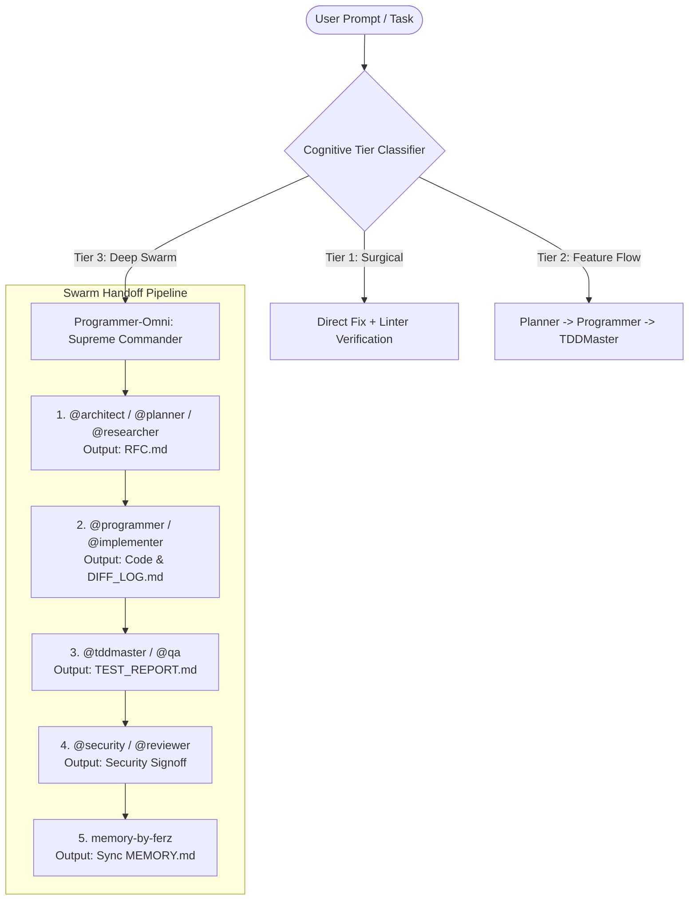

# ⚡ BUKU PANDUAN TITANIUM SWARM v4.5: TAKSONOMI & ORKESTRASI 46 SUB-AGEN

> **Sistem**: Freebuff Superpower Ultra (Titanium Swarm Edition v4.5)  
> **Koleksi**: 46 Specialized Autonomous Sub-Agents & 1055 Modular Engineering Skills  
> **Peruntukan**: Dokumen Referensi Teknis & Integrasi Buku Panduan PDF

---

## 1. EXECUTIVE SUMMARY & ARSITEKTUR SWARM

Sistem **Titanium Swarm Edition v4.5** mengadopsi paradigma *Multi-Agent Autonomous Orchestration*, di mana beban komputasi kognitif dan rekayasa perangkat lunak didelegasikan ke unit-unit sub-agen terspesialisasi tinggi. Setiap agen memiliki bounded context yang ketat, aturan anti-AI-slop yang absolut, serta protokol handoff berbasis artefak formal (`RFC.md`, `DIFF_LOG.md`, `TEST_REPORT.md`, dan `MEMORY.md`).



### 3-Tier Execution Matrix

| Complexity Tier | Trigger Conditions | Mandatory Protocol |
|---|---|---|
| **Tier 1: Surgical** | Typo fix, single variable rename, styling CSS mikro. | Eksekusi langsung tanpa pembengkakan rencana. Verifikasi lint & build. |
| **Tier 2: Feature Flow** | Endpoint baru, komponen UI baru, skema migrasi tabel. | `@planner` $\rightarrow$ `@programmer` $\rightarrow$ `@tddmaster`. |
| **Tier 3: Deep Swarm** | Arsitektur ulang, sistem payment/auth, migrasi distributed ledger. | Wajib menyusun `RFC.md` formal, menjalankan dual-gate QA, audit OWASP, dan persistensi memory. |

---

## 2. DUAL-GATE QUALITY INVARIANTS (STRICT PASS/FAIL)

Setiap sub-agen dalam swarm beroperasi di bawah 2 gerbang kualitas mutlak:

### Gerbang 1: Static Quality Invariants
1. **Zero Compiler & Linter Errors**: Mode TypeScript super ketat (`noImplicitAny: true`), zero type coercion.
2. **Zero AI Slop**: Dilarang keras memunculkan kode tiruan / stub (`// TODO: implement later`), elipsis pemotongan (`...`), atau placeholder basa-basi.
3. **Hallucination Circuit-Breaker**: Seluruh impor modul wajib diverifikasi keberadaannya dalam registry dan package manifest.

### Gerbang 2: Behavioral Verification Invariants
1. **Happy-Path Verification**: Minimal 1 pengujian otomatis unit/integrasi untuk memastikan output valid.
2. **Negative Edge-Case Defense**: Minimal 2 skenario uji kasus ekstrem (token kedaluwarsa, payload kosong, kegagalan jaringan, timeout).
3. **Self-Healing Loop**: Bila ada failure, memicu `[Skill: autonomous-swe-loop-healer]` otomatis tanpa intervensi manual.

---

## 3. PEMETAAN 46 SUB-AGEN KE DALAM 9 CLUSTER SPESIALISASI

Ke-46 sub-agen dikelompokkan secara presisi ke dalam **9 Cluster Domain Spesialisasi**:

| # | Cluster Domain | Jumlah Agen | Fokus Inti Rekayasa |
|---|---|:---:|---|
| **1** | Architecture & System Design | 7 | Perancangan arsitektur tingkat tinggi, navigasi dependensi, orkestrasi swarm, dan riset mendalam. |
| **2** | Frontend & UI/UX Experience | 8 | Antarmuka pengguna, aksesibilitas WCAG, 3D WebGL, animasi mikro, SEO, dan PWA offline. |
| **3** | Backend & Database Engineering | 6 | API resilient, transaksi ACID, streaming real-time, perancangan skema DB, dan OLAP analitik. |
| **4** | Core Implementation & Craftsmanship | 3 | Rekayasa bedah presisi, implementasi fullstack end-to-end, dan refaktorisasi AST. |
| **5** | Mobile & Cross-Platform | 2 | Aplikasi hybrid/native iOS & Android, flutter gesture physics, dan offline synchronization. |
| **6** | AI, NLP & Cognitive Systems | 5 | RAG tingkat lanjut, hybrid retrieval, penalaran matematika/algoritmik, dan red-teaming AI. |
| **7** | DevOps, Cloud Native & SRE | 4 | Otomasi CI/CD, klaster Kubernetes/Helm, observabilitas SLO, dan orkestrasi rilis. |
| **8** | Security, Governance & Auditing | 5 | Audit OWASP Top 10, Cloud Zero-Trust, Smart Contract EVM, code review independen, dan dokumentasi. |
| **9** | Performance, QA & Forensics Testing | 6 | TDD red-green, testing Playwright E2E, injeksi kekacauan (chaos k6), dan forensik kernel/memory. |

---

## 4. KATALOG RINCIAN SUB-AGEN BERDASARKAN CLUSTER

### CLUSTER 1: ARCHITECTURE & SYSTEM DESIGN (7 Sub-Agen)

Peran klaster ini adalah menyusun fondasi logika, kontrak interface, batasan bounded context, dan dekomposisi problem tingkat pertama sebelum kode ditulis.

#### 1. `@programmer-omni`
- **File**: `.freebuff/agents/programmer-omni.md`
- **Peran**: *Supreme Commander (Mode Bantai)* — Orchestrator Tertinggi dari seluruh sub-agen. Mengendalikan autonomous deep research, multi-agent dispatching, dan governance dual-gate QA.
- **Keunggulan**: Memiliki otoritas penuh atas sub-agent tools dan 66 curated skills; mampu menjalankan autonomous feedback loop hingga task benar-benar tuntas tanpa degradasi mutu.
- **Trigger**: Tugas skala enterprise monorepo, migrasi arsitektur masif, atau orkestrasi multi-task kompleks.

#### 2. `@architect`
- **File**: `.freebuff/agents/architect.md`
- **Peran**: *High-Level System Architect*. Bertanggung jawab atas dekomposisi first-principles, prinsip Gall's Law, dan penyusunan dokumen formal `RFC.md`.
- **Keunggulan**: Mengisolasi domain logic dari framework transport (HTTP/gRPC/CLI) dan memproduksi skema DDL/Zod/Pydantic yang strictly typed.
- **Output Utama**: `RFC.md`, diagram C4, data contract DDL/Zod, dan format error RFC 7807.

#### 3. `@planner`
- **File**: `.freebuff/agents/planner.md`
- **Peran**: *Task Decomposition & Roadmap Strategist*. Memecah fitur menjadi dependensi berarah (DAG) yang dapat diparalelkan tanpa menyentuh source code.
- **Keunggulan**: Mengantisipasi deadlock dependensi dan mendefinisikan kriteria penerimaan (Acceptance Criteria) yang objektif untuk agen implementer.
- **Output Utama**: WBS (Work Breakdown Structure), rencana fase eksekusi bertahap.

#### 4. `@researcher`
- **File**: `.freebuff/agents/researcher.md`
- **Peran**: *Autonomous Deep Researcher*. Menelusuri dokumentasi teknis global, benchmark kompetitor, whitepaper, dan forensik open-source.
- **Keunggulan**: Kemampuan sintesis informasi web dan codebase internal tingkat tinggi dengan verifikasi fakta silang anti-halusinasi.
- **Output Utama**: Laporan komparasi arsitektur, evaluasi trade-off pustaka/teknologi.

#### 5. `@explore-plus`
- **File**: `.freebuff/agents/explore-plus.md`
- **Peran**: *Codebase Navigator & Dependency Mapper*. Memetakan entry-point, flow kontrol data, call graph, dan siklus dependensi dalam kode legacy.
- **Keunggulan**: Analisis statis berkecepatan tinggi yang mencegah 'blind-editing' pada codebase berukuran besar.
- **Output Utama**: Graph pemetaan alur eksekusi, inventaris titik rawan regresi.

#### 6. `@monorepo-architect`
- **File**: `.freebuff/agents/monorepo-architect.md`
- **Peran**: *Enterprise Workspace & Package Isolation Architect*. Mengelola Turborepo, Nx, PNPM workspaces, dan caching build graph.
- **Keunggulan**: Mencegah phantom dependency dan sirkularitas import antar-package dalam arsitektur monorepo skala raksasa.
- **Output Utama**: Konfigurasi workspace pipeline, shared tooling tsconfig/eslint, dependency boundary guard.

#### 7. `@microservices-mesh`
- **File**: `.freebuff/agents/microservices-mesh.md`
- **Peran**: *Distributed Systems & Mesh Architect*. Merancang topologi microservices berbasis Istio service mesh, gRPC streaming, Kafka event backbone, dan CQRS.
- **Keunggulan**: Menerapkan pola fault tolerance terdistribusi (bulkhead, circuit breaker, retry jitter) dan tracing end-to-end W3C traceparent.
- **Output Utama**: Protobuf definitions, Kafka schema registry, Istio VirtualService & DestinationRule.

---

### CLUSTER 2: FRONTEND & UI/UX EXPERIENCE (8 Sub-Agen)

Klaster ini bertugas menciptakan antarmuka modern, interaktif, responsif, berkinerja 60 FPS, dan memenuhi standar aksesibilitas internasional.

#### 8. `@frontend`
- **File**: `.freebuff/agents/frontend.md`
- **Peran**: *Modern React/Next.js UI Specialist*. Mengembangkan komponen UI elegan menggunakan Next.js App Router, React Server Components (RSC), Tailwind CSS, dan shadcn/ui.
- **Keunggulan**: Menerapkan prinsip *Anti-AI-Slop* desain (menolak gradien generik, margin tidak proporsional, atau animasi murahan).
- **Output Utama**: Komponen modular strictly typed dengan zero layout shift (CLS: 0).

#### 9. `@design-engineer`
- **File**: `.freebuff/agents/design-engineer.md`
- **Peran**: *Bridge between Brand, Tokens & Frontend Implementation*. Menerjemahkan visual token, tipografi fluid, dan sistem kisi (grid) ke dalam CSS terstruktur.
- **Keunggulan**: Menjaga kohesi estetika visual tingkat desainer papan atas dengan detail mikro (border neon halus, glassmorphic surface, OKLCH color space).
- **Output Utama**: Sistem token desain terpadu, varian CVA (Class Variance Authority), micro-interactions.

#### 10. `@generative-ui-engineer`
- **File**: `.freebuff/agents/generative-ui-engineer.md`
- **Peran**: *AI-Driven Generative UI Specialist*. Mengintegrasikan antarmuka dinamis berbasis streaming komponen AI menggunakan Vercel AI SDK RSC, client-side WebGPU, dan tool-calling rendering.
- **Keunggulan**: Merender antarmuka adaptif yang bereaksi secara real-time terhadap payload model AI tanpa reload halaman.
- **Output Utama**: Streaming UI widgets, chat-driven generative interfaces.

#### 11. `@game-dev-3d`
- **File**: `.freebuff/agents/game-dev-3d.md`
- **Peran**: *3D Web Graphics & Spatial Developer*. Membangun pengalaman interaktif 3D di browser menggunakan Three.js, React Three Fiber (R3F), GLSL custom shaders, dan physics engines.
- **Keunggulan**: Optimasi rendering loop 60 FPS pada GPU seluler melalui batched draw calls, texture atlas, dan geometry instancing.
- **Output Utama**: Interactive 3D visualizers, shader materials, WebGL canvas components.

#### 12. `@accessibility-champion`
- **File**: `.freebuff/agents/accessibility-champion.md`
- **Peran**: *WCAG 2.2 AAA Compliance Specialist*. Mengaudit dan menjamin aksesibilitas total pada keyboard navigation, live region screen reader (`aria-live`), dan rasio kontras warna.
- **Keunggulan**: Menjamin pengguna penyandang disabilitas mendapatkan pengalaman sempurna tanpa ada trap focus keyboard yang menjebak.
- **Output Utama**: Accessible dialog/modal focus traps, semantic ARIA roles, checklist validasi WCAG AAA.

#### 13. `@localization-i18n-pro`
- **File**: `.freebuff/agents/localization-i18n-pro.md`
- **Peran**: *Enterprise Internationalization (i18n) Architect*. Mengatur dynamic routing multi-bahasa, ICU translation format, dan penanganan Right-to-Left (RTL) CSS logical properties.
- **Keunggulan**: Menghindari pergeseran tata letak saat pergantian arah teks LTR/RTL dan format currency/date lokal.
- **Output Utama**: Schema terjemahan i18n terisolasi, skrip validasi kelengkapan string multi-bahasa.

#### 14. `@seo-growth`
- **File**: `.freebuff/agents/seo-growth.md`
- **Peran**: *Programmatic SEO & GEO Optimization Specialist*. Mengoptimalkan crawlability, Schema.org JSON-LD (Product, Article, FAQ, LocalBusiness), dynamic OpenGraph cards, dan Core Web Vitals.
- **Keunggulan**: Mengintegrasikan strategi optimasi generative search engine (GEO) untuk AI citation indexing (ChatGPT Search, Perplexity, Gemini).
- **Output Utama**: Dynamic sitemap generator, JSON-LD structured data, metadata templates.

#### 15. `@pwa-offline-architect`
- **File**: `.freebuff/agents/pwa-offline-architect.md`
- **Peran**: *Progressive Web App & Offline-First Architect*. Membangun arsitektur Service Worker (Workbox), runtime cache strategy (stale-while-revalidate), dan background sync.
- **Keunggulan**: Memastikan aplikasi dapat beroperasi tanpa jaringan internet dengan sinkronisasi otomatis saat online kembali.
- **Output Utama**: Service worker manifest, indexedDB local storage layer, install banner prompts.

---

### CLUSTER 3: BACKEND & DATABASE ENGINEERING (6 Sub-Agen)

Klaster ini bertindak sebagai penjaga integritas data, ketersediaan API, konkurensi tinggi, dan konsistensi transaksi finansial.

#### 16. `@backend`
- **File**: `.freebuff/agents/backend.md`
- **Peran**: *Production-Safe API & Service Specialist*. Merancang RESTful dan gRPC endpoints, integrasi autentikasi modern (JWT/Passkeys), dan background job queues.
- **Keunggulan**: Mengedepankan prinsip defensif: skema input tervalidasi ketat (Zod/Pydantic), error handling konsisten RFC 7807, dan zero SQL injection.
- **Output Utama**: Service layer controller, route handlers, middleware pelindung.

#### 17. `@database`
- **File**: `.freebuff/agents/database.md`
- **Peran**: *Database Architect & Query Optimizer*. Merancang skema relasional/NoSQL, partial indexing, foreign key constraints, dan zero-downtime migration scripts.
- **Keunggulan**: Menganalisis `EXPLAIN ANALYZE` query plans untuk memangkas sequential table scans dan mencegah connection pool exhaustion.
- **Output Utama**: Migration files, DDL schema, optimized indexes, tuning PRAGMA/Postgres configuration.

#### 18. `@data-engineer-olap`
- **File**: `.freebuff/agents/data-engineer-olap.md`
- **Peran**: *Real-Time Analytics & Data Pipeline Engineer*. Membangun arsitektur analytical SQL terdistribusi menggunakan ClickHouse, DuckDB in-process, dan Parquet storage.
- **Keunggulan**: Mampu memproses jutaan event analitik per detik dengan latensi kueri agregasi sub-detik tanpa membebani database operasional OLTP.
- **Output Utama**: Event streaming ingestion pipeline, columnar table models, materialized views.

#### 19. `@websocket-realtime`
- **File**: `.freebuff/agents/websocket-realtime.md`
- **Peran**: *Real-Time Transport & State Synchronization Specialist*. Menangani protokol WebSockets bidirectional, Server-Sent Events (SSE), dan Redis Pub/Sub clusters.
- **Keunggulan**: Manajemen connection heartbeat, auto-reconnection dengan exponential backoff, dan tracking presence user skala besar.
- **Output Utama**: WebSocket event gateway, room subscription manager, failover handlers.

#### 20. `@fintech-architect`
- **File**: `.freebuff/agents/fintech-architect.md`
- **Peran**: *Payment Lifecycle & Webhook Architect*. Mengintegrasikan payment gateway (Xendit, Midtrans, Stripe), idempotency keys, dan alur checkout transaksional.
- **Keunggulan**: Memastikan zero duplicate payments melalui distributed locks dan penanganan replay webhook yang kebal kegagalan jaringan.
- **Output Utama**: Webhook signature verification, idempotent mutation handlers, payment state machines.

#### 21. `@tokenomics-fintech-ledger`
- **File**: `.freebuff/agents/tokenomics-fintech-ledger.md`
- **Peran**: *Double-Entry Bookkeeping & Cryptographic Ledger Specialist*. Menerapkan sistem akuntansi entri ganda (Double-Entry Ledger) dengan transaksi ACID murni.
- **Keunggulan**: Menjamin setiap mutasi saldo memiliki pencatatan debit dan kredit yang seimbang secara matematis dengan immutable audit trail.
- **Output Utama**: Ledger transaction schema, ledger validation assertions, balance reconciliation scripts.

---

### CLUSTER 4: CORE IMPLEMENTATION & CRAFTSMANSHIP (3 Sub-Agen)

Klaster eksekutor murni yang menghasilkan kode dengan standar keahlian tertinggi (*Hallmark Craftsmanship*), bersih dari slop, dan berpresisi bedah.

#### 22. `@programmer`
- **File**: `.freebuff/agents/programmer.md`
- **Peran**: *Precision Surgical Engineer v3.5*. Mengimplementasikan logika fitur dengan fokus single-stream execution, minimal diff, dan penolakan keras terhadap kode generik AI.
- **Keunggulan**: Menghasilkan kode elegan berorientasi manusia: penamaan variabel yang self-explanatory, eliminasi percabangan rumit (*guard clauses*), dan integrasi otomatis ke memori proyek.
- **Output Utama**: Clean production-ready source code, file modifikasi minimal.

#### 23. `@implementer`
- **File**: `.freebuff/agents/implementer.md`
- **Peran**: *Fullstack End-to-End Implementer*. Menjembatani kode frontend dan backend secara utuh dalam satu siklus iterasi yang teruji build-nya.
- **Keunggulan**: Memastikan bahwa implementasi API langsung sinkron dengan UI consumption tanpa ada type mismatch atau contract breaking.
- **Output Utama**: Terobosan fitur fullstack siap pakai, verifikasi status build lokal.

#### 24. `@refactor-expert`
- **File**: `.freebuff/agents/refactor-expert.md`
- **Peran**: *AST Migration & Clean Architecture Modernizer*. Melakukan refaktorisasi struktural berskala besar menggunakan Abstract Syntax Tree (AST), Babel, dan SWC.
- **Keunggulan**: Menghilangkan *code smell*, memecah fungsi monolitik, dan menerapkan Clean Architecture tanpa sedikit pun mengubah perilaku fungsional (*zero regression*).
- **Output Utama**: Transformasi kode terstruktur, penghapusan tech debt legacy.

---

### CLUSTER 5: MOBILE & CROSS-PLATFORM (2 Sub-Agen)

Klaster pengembang ekosistem native dan hybrid untuk platform seluler iOS dan Android.

#### 25. `@mobile-engineer`
- **File**: `.freebuff/agents/mobile-engineer.md`
- **Peran**: *Cross-Platform Native Developer (React Native & Flutter)*. Merancang aplikasi seluler berperforma tinggi dengan native bridge, touch gesture physics, dan swipeable bottom sheets.
- **Keunggulan**: Mencegah memory leak pada list render panjang (Virtualization) dan menangani siklus hidup aplikasi di latar belakang (*background fetch/sync*).
- **Output Utama**: Komponen mobile native-like, konfigurasi Expo/Flutter build pipelines.

#### 26. `@flutter-specialist`
- **File**: `.freebuff/agents/flutter-specialist.md`
- **Peran**: *Dedicated Flutter & Dart Expert*. Membangun aplikasi cross-platform dengan arsitektur reaktif BLoC/Riverpod, animasi CustomPainter, dan native platform channels.
- **Keunggulan**: Keahlian mendalam pada Dart sound null-safety, isolasi isolate thread untuk komputasi berat, dan rendering pixel-perfect di Android & iOS.
- **Output Utama**: BLoC state providers, CustomPainter canvas widgets, platform channel bindings.

---

### CLUSTER 6: AI, NLP & COGNITIVE SYSTEMS (5 Sub-Agen)

Klaster yang mengelola inteligensi buatan, retrieval terdistribusi, penalaran matematis murni, dan pertahanan terhadap serangan model AI.

#### 27. `@ai-engineer`
- **File**: `.freebuff/agents/ai-engineer.md`
- **Peran**: *AI & Vector Database Specialist*. Mengintegrasikan ekosistem LLM ke dalam aplikasi melalui pgvector, Qdrant, model fallback routing, dan manajemen kuota token.
- **Keunggulan**: Mencegah bottleneck biaya dan latensi dengan menerapkan semantic caching dan token allocation budgeting.
- **Output Utama**: Vector similarity query layers, LLM client wrappers, embedding generators.

#### 28. `@nlp-rag-specialist`
- **File**: `.freebuff/agents/nlp-rag-specialist.md`
- **Peran**: *Advanced Agentic RAG & Hybrid Retrieval Specialist*. Merancang pipeline pengambilan dokumen cerdas menggabungkan BM25 lexical keyword dan Dense Vector embeddings yang disempurnakan dengan Cohere Rerank v3.
- **Keunggulan**: Mengeliminasi fenomena halusinasi AI dengan teknik chunking semantik dinamis dan evaluasi relevansi retrieval.
- **Output Utama**: RAG ingestion pipelines, hybrid retrieval handlers, re-ranking scoring logic.

#### 29. `@deepseek-reasoner-pro`
- **File**: `.freebuff/agents/deepseek-reasoner-pro.md`
- **Peran**: *Mathematical & Cognitive Reasoning Specialist*. Menyelesaikan problem komputasi rumit, pembuktian kebenaran algoritma, kompresi graf, dan pemecahan teka-teki logika multi-tahap.
- **Keunggulan**: Kemampuan dekonstruksi masalah non-deterministik menjadi model matematika formal dan optimasi kompleksitas ruang/waktu ($O(N \log N)$).
- **Output Utama**: Algoritma optimasi matematika, analisis kompleksitas asimptotik, model probabilitas.

#### 30. `@glm-chat`
- **File**: `.freebuff/agents/glm-chat.md`
- **Peran**: *Rapid Ideation & Brainstorming Engine*. Agen konsultasi berkecepatan tinggi (144 tok/s) untuk brainstorming ide fitur, alternatif solusi teknis, dan copy ideation.
- **Keunggulan**: Kecepatan generasi respon yang instan untuk menstimulasi skenario alternatif sebelum masuk ke fase perancangan formal.
- **Output Utama**: Ringkasan diskusi ide, perbandingan cepat opsi solusi.

#### 31. `@prompt-red-teamer`
- **File**: `.freebuff/agents/prompt-red-teamer.md`
- **Peran**: *AI Security & Adversarial Defense Specialist*. Menguji kerentanan sistem AI terhadap indirect prompt injection, jailbreak prompts, kebocoran system instructions, dan keracunan data.
- **Keunggulan**: Mengimplementasikan layer NeMo Guardrails dan semantic validation regex untuk memfilter input jahat sebelum menyentuh model LLM.
- **Output Utama**: Laporan celah prompt injection, guardrail policies, test suite skenario penyerangan.

---

### CLUSTER 7: DEVOPS, CLOUD NATIVE & SRE (4 Sub-Agen)

Klaster yang bertanggung jawab atas kestabilan infrastruktur, otomatisasi rilis, kontainerisasi, dan pemenuhan Service Level Objectives (SLO).

#### 32. `@devops`
- **File**: `.freebuff/agents/devops.md`
- **Peran**: *Cloud Infrastructure & CI/CD Engineer*. Mengonfigurasi Docker multi-stage builds, GitHub Actions pipelines, skrip Terraform, dan server automation.
- **Keunggulan**: Menjamin ukuran image container minimal (< 50MB) dan proses build CI yang terisolasi serta kebal kegagalan *caching stale*.
- **Output Utama**: Dockerfile teroptimasi, workflow GitHub Actions, skrip deployment bash POSIX.

#### 33. `@cloud-native-devops-k8s`
- **File**: `.freebuff/agents/cloud-native-devops-k8s.md`
- **Peran**: *Enterprise Kubernetes & GitOps Architect*. Mengelola manifest Kubernetes, Helm charts, ArgoCD continuous deployment, dan serverless scaling di AWS/GCP.
- **Keunggulan**: Mengonfigurasi Horizontal Pod Autoscaler (HPA), PDB (Pod Disruption Budgets), dan Zero-Downtime Rolling Update strategy.
- **Output Utama**: Production-grade Helm charts, K8s ingress resources, ArgoCD application manifests.

#### 34. `@sre`
- **File**: `.freebuff/agents/sre.md`
- **Peran**: *Site Reliability Engineer & Incident Manager*. Merancang instrumen observabilitas (Prometheus metrics, Grafana dashboards), mendefinisikan SLA/SLO/SLI, dan mengelola budget error.
- **Keunggulan**: Analisis proaktif terhadap degradasi performa sebelum menimbulkan outage melalui sistem peringatan dini (early warning alerting).
- **Output Utama**: File konfigurasi alert Prometheus, post-mortem incident runbooks, dashboard JSON.

#### 35. `@release`
- **File**: `.freebuff/agents/release.md`
- **Peran**: *Semantic Release & Distribution Manager*. Mengatur penomoran versi SemVer, kompilasi changelog otomatis berbasis git history, dan orkestrasi rilis GitHub Releases.
- **Keunggulan**: Memastikan tidak ada breaking change yang terlewat dari catatan rilis dan menandatangani artifact build secara aman.
- **Output Utama**: File CHANGELOG.md, release tag triggers, asset bundler.

---

### CLUSTER 8: SECURITY, GOVERNANCE & AUDITING (5 Sub-Agen)

Klaster garda depan yang menjaga kepatuhan kode, privasi data, validasi kontrak pintar Web3, dan integritas dokumentasi proyek.

#### 36. `@security`
- **File**: `.freebuff/agents/security.md`
- **Peran**: *Application Security & OWASP Auditor*. Melakukan audit statis dan dinamis terhadap celah keamanan (OWASP Top 10), kebocoran token rahasia (.env), dan konfigurasi header HTTP.
- **Keunggulan**: Mencegah injeksi XSS, CSRF, insecure direct object reference (IDOR), dan membekukan build jika ditemukan secret tersimpan di repositori.
- **Output Utama**: Laporan audit keamanan, konfigurasi CSP (Content Security Policy), sanitasi input.

#### 37. `@cloud-security-architect`
- **File**: `.freebuff/agents/cloud-security-architect.md`
- **Peran**: *Cloud Infrastructure Security & Zero-Trust Architect*. Merancang kebijakan IAM least-privilege di AWS/GCP, isolasi Virtual Private Cloud (VPC), dan manajemen rahasia terenkripsi KMS/Vault.
- **Keunggulan**: Memastikan komunikasi antar-layanan berjalan di atas Zero-Trust Network mTLS tanpa port publik terbuka yang tidak diperlukan.
- **Output Utama**: Kebijakan IAM JSON, arsitektur VPC security groups, panduan audit kepatuhan ISO 27001/SOC2.

#### 38. `@smart-contract-auditor`
- **File**: `.freebuff/agents/smart-contract-auditor.md`
- **Peran**: *Web3 & EVM Solidity Security Auditor*. Memeriksa smart contract dari kerentanan kritis reentrancy, integer overflow, flash loan exploits, dan inefisiensi konsumsi gas Yul/Assembly.
- **Keunggulan**: Menjalankan automated fuzz testing menggunakan Foundry dan invariant checking untuk memverifikasi keamanan dana on-chain.
- **Output Utama**: Laporan kerentanan smart contract, profil optimasi gas snapshot, invariant test suites.

#### 39. `@reviewer`
- **File**: `.freebuff/agents/reviewer.md`
- **Peran**: *Independent Code Reviewer & Correctness Auditor*. Melakukan inspeksi kode tanpa mengubah file, mengevaluasi kesesuaian arsitektur, kelayakan unit test, dan eliminasi anti-pattern.
- **Keunggulan**: Menjadi gerbang penilai objektif yang menolak PR jika mengandung kelemahan performa, duplikasi logika, atau AI slop filler.
- **Output Utama**: Catatan review PR berbobot tinggi, skor kesiapan produksi (*Production Readiness Score*).

#### 40. `@writer`
- **File**: `.freebuff/agents/writer.md`
- **Peran**: *Technical Writer & Knowledge Engineer*. Mengonversi arsitektur sistem, skema API, dan catatan operasional ke dalam dokumentasi berstandar industri (README, Docs, User Guides).
- **Keunggulan**: Menghasilkan tulisan yang tajam, padat, berorientasi nilai bisnis dan teknik, bebas dari frasa klise AI.
- **Output Utama**: Dokumentasi panduan teknis, format buku panduan PDF, changelog ringkas.

---

### CLUSTER 9: PERFORMANCE, QA & FORENSICS TESTING (6 Sub-Agen)

Klaster validasi perilaku sistem di bawah beban ekstrem, isolasi anomali memori, dan penjaminan kualitas kode berbasis test-driven development.

#### 41. `@tddmaster`
- **File**: `.freebuff/agents/tddmaster.md`
- **Peran**: *Automated Testing & TDD Champion*. Memimpin metodologi Red-Green-Refactor, merancang pengujian unit strictly typed, dan membangun matriks kasus ekstrem (*edge-cases*).
- **Keunggulan**: Menjamin zero flakiness pada test suite dengan isolasi mock fakes yang deterministik.
- **Output Utama**: Test suite unit/integrasi (Vitest/Jest/Pytest), matriks skenario failure.

#### 42. `@qa`
- **File**: `.freebuff/agents/qa.md`
- **Peran**: *End-to-End Test Automation Specialist*. Merancang skenario pengujian alur pengguna nyata (User Journey) menggunakan Playwright E2E, mock fixture data, dan regresi visual.
- **Keunggulan**: Mampu menyimulasikan multi-role user concurrency dan memvalidasi rendering antarmuka di berbagai ukuran layar secara otomatis.
- **Output Utama**: Script Playwright E2E, rekaman trace artefak failure, laporan defect triage.

#### 43. `@chaos-tester`
- **File**: `.freebuff/agents/chaos-tester.md`
- **Peran**: *Chaos Engineering & Load Testing Specialist*. Menguji ketahanan aplikasi di bawah lonjakan lalu lintas ekstrem menggunakan Grafana k6, simulasi packet loss, dan fault injection.
- **Keunggulan**: Mengidentifikasi titik patah sistem (breakpoint capacity) dan memverifikasi aktivasi failover circuit-breaker saat database melambat.
- **Output Utama**: Script k6 stress testing, grafik throughput vs error rate, laporan ketahanan sistem.

#### 44. `@perf`
- **File**: `.freebuff/agents/perf.md`
- **Peran**: *Runtime & Memory Performance Optimizer*. Menganalisis CPU flamegraphs, alokasi heap JavaScript, dan bottlenecks I/O untuk memangkas latensi P99.
- **Keunggulan**: Menerapkan optimasi minimal diff yang menghasilkan kenaikan throughput signifikan (misal: unblocking event loop, memoization tepat sasaran).
- **Output Utama**: Analisis sebelum vs sesudah optimasi (Benchmark Diff), patch penyeimbang load.

#### 45. `@debugger`
- **File**: `.freebuff/agents/debugger.md`
- **Peran**: *Systematic Bug Isolator & Minimal Patch Engineer*. Mereproduksi bug secara deterministik, mengisolasi akar masalah (*root cause*), dan meracik patch perbaikan bedah.
- **Keunggulan**: Menolak solusi coba-coba (*trial and error*); selalu membuat skenario tes yang gagal sebelum menerapkan perbaikan kode.
- **Output Utama**: Minimal reproducing test case, surgical patch fix.

#### 46. `@system-debugger-forensics`
- **File**: `.freebuff/agents/system-debugger-forensics.md`
- **Peran**: *Low-Level Kernel & Memory Forensics Debugger*. Menyelidiki kebocoran memori misterius, race condition tersembunyi, zombie processes, dan latensi syscall menggunakan eBPF tracing dan core dump analysis.
- **Keunggulan**: Menembus batas abstraksi aplikasi hingga ke level kernel Linux untuk menemukan kelemahan concurrency yang mustahil dilihat debugger biasa.
- **Output Utama**: eBPF trace analysis, heap snapshot dumps, laporan resolusi race condition.

---

## 5. PROTOKOL HANDOFF & ALUR KOLABORASI SWARM

Di dalam sistem Titanium Swarm v4.5, koordinasi antar sub-agen berlangsung melalui **Artefak Formal Terstandarisasi** untuk mencegah distorsi informasi kognitif (*lossy context*):

```
+-----------------------------------------------------------------------------------+
|                            TITANIUM SWARM HANDOFF PIPELINE                        |
+-----------------------------------------------------------------------------------+
|                                                                                   |
|  [ Fase 1: Discovery & RFC ]                                                      |
|  @architect / @planner / @researcher                                              |
|      |                                                                            |
|      v Menghasilkan: RFC.md (Interface schemas, API contract, DDL)                 |
|                                                                                   |
|  [ Fase 2: Core Engineering ]                                                     |
|  @programmer / @implementer / @frontend / @backend                                |
|      |                                                                            |
|      v Menghasilkan: Source Code + DIFF_LOG.md (Anti-slop, strictly typed)         |
|                                                                                   |
|  [ Fase 3: Verification & Defense ]                                               |
|  @tddmaster / @qa / @chaos-tester                                                 |
|      |                                                                            |
|      v Menghasilkan: TEST_REPORT.md (Dual-gate verification passes)               |
|                                                                                   |
|  [ Fase 4: Security & Code Governance ]                                           |
|  @security / @reviewer                                                            |
|      |                                                                            |
|      v Menghasilkan: OWASP Signoff & Security Audit Clearance                     |
|                                                                                   |
|  [ Fase 5: Memory Persistence & Docs ]                                            |
|  @writer + [Skill: memory-by-ferz]                                                |
|      |                                                                            |
|      v Menghasilkan: Sinkronisasi MEMORY.md & Update Release Changelog             |
|                                                                                   |
+-----------------------------------------------------------------------------------+
```

### Format Kontrak Handoff Antar Sub-Agen

1. **`RFC.md` (Spesifikasi Teknis Awal)**:
   - Dibuat oleh `@architect` atau `@planner`.
   - Wajib mencantumkan schema Zod/TypeScript, endpoint request/response, dan batasan invariant.
   - Menjadi acuan mutlak bagi agen pengembang (`@programmer`) dan penguji (`@tddmaster`).

2. **`DIFF_LOG.md` (Catatan Implementasi)**:
   - Dihasilkan oleh `@programmer` atau `@implementer`.
   - Menjelaskan rasional keputusan non-obvious, file yang ditambahkan/dimodifikasi, dan jaminan zero AI slop.

3. **`TEST_REPORT.md` (Validasi Kualitas)**:
   - Dihasilkan oleh `@tddmaster` atau `@qa`.
   - Membuktikan kelulusan minimal 1 tes happy-path dan minimal 2 tes negative/edge-case.
   - Menampilkan status lulus 100% build compiler dan test suite.

4. **`MEMORY.md` (Sinkronisasi Pengetahuan Bersama)**:
   - Dipersistensikan oleh `[Skill: memory-by-ferz]`.
   - Menyimpan riwayat keputusan arsitektur, konvensi penamaan yang telah disepakati, dan status milestone proyek agar bertahan melintasi sesi obrolan yang berbeda.

---

## 6. PANDUAN INTEGRASI KE DALAM DOKUMEN BUKU PANDUAN PDF

Untuk menyusun laporan buku panduan PDF yang memukau dewan juri lomba:

1. **Infografis Taksonomi Radar (Visual Wheel)**:
   - Gunakan diagram lingkaran 9 sektor yang menampilkan kesembilan klaster dengan 46 sub-agen melingkar di sekelilingnya.
   - Berikan aksen warna khusus untuk masing-masing klaster (misal: *Amber* untuk Supreme Commander, *Cyan* untuk Frontend, *Emerald* untuk Backend & Database, *Rose* untuk Security & QA).

2. **Tabel Ringkas Komparasi Peran**:
   - Cantumkan tabel matriks 46 agen sebagai lampiran teknis (Technical Appendix) di bagian akhir buku panduan PDF.
   - Sertakan badge verifikasi: `Strict Anti-AI-Slop`, `Dual-Gate QA`, dan `Memory-by-Ferz Synced`.

3. **Studi Kasus Eksekusi Nyata (Contoh: Fitur Pemesanan Servis Cepat & Realtime Tracking)**:
   - Sajikan narasi singkat bagaimana `@planner` membedah alur pesanan menjadi state machine FSM.
   - Tunjukkan bagaimana `@database` mengunci skema dengan indeks parsial, `@websocket-realtime` menyiarkan status teknisi secara live, `@tddmaster` memastikan pesanan tidak dapat diduplikasi, dan `@security` memastikan data lokasi terlindungi.

---
*Dokumen ini disusun otomatis oleh Sub-Agent Swarm Agent Analyst untuk integrasi materi teknis Titanium Swarm v4.5 ke dalam buku panduan kompetisi.*
